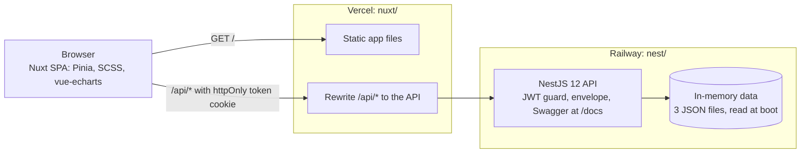

# Susi Air Pilot App

A web app for one airline pilot. It shows the duty calendar, flight hours against the daily, weekly, monthly, and annual limits, and document expiry. The data is mock data for John Doe. The API loads three JSON files at startup and never writes to them.

**Status:** deployed and tested. Web app: https://susi-air-web.vercel.app. API: https://nest-production-f9b4.up.railway.app (Swagger at `/docs`). The smoke suite passes against the live site (12 of 12). Known issue: one Playwright run after a fresh install failed on Home. It did not recur in the three runs after it.

The spec is the source of truth.

## System



Locally, the Nuxt dev server on port 3000 forwards `/api` to the API on port 3001, so the browser sees one origin, as it does in production. The Docker web app calls the API on port 3001 directly, so the API allows that origin with CORS.

## Repo layout

```
nest/      API: NestJS 12, in-memory data, JWT login, Swagger
           src/domains/  one folder per domain: auth, pilot, flight-hours, documents, schedules
nuxt/      Web app: Nuxt 3 SPA, Pinia, SCSS, vue-echarts
```

`nest/` and `nuxt/` each have their own `package.json` and lockfile. There is no root workspace.

## Requirements

- Node 26.10.0 and pnpm 12.8.1 for running without Docker. These are the versions I tested. Other versions are untested.
- Docker with Compose, for the one-command run below.

## Run with Docker

Needs Docker with Compose. From the repo root:

```sh
docker compose up --build
```

- Web app: http://localhost:3000. Sign in with `johndoe` / `susiairtest`.
- API: http://localhost:3001. Swagger UI: http://localhost:3001/docs.

The containers run the production builds. The demo defaults in `docker-compose.yml` let the stack start with no setup. Set your own secret before sharing it:

```sh
JWT_SECRET=$(openssl rand -hex 32) docker compose up --build
```

Stop the stack with `docker compose down`.

## Set up and run

### API (`nest/`)

```sh
cd nest
pnpm install
pnpm start:dev
```

- API: http://localhost:3001
- Swagger UI: http://localhost:3001/docs

### Web app (`nuxt/`)

Start the API first. The web app sends `/api` requests to it.

```sh
cd nuxt
pnpm install
pnpm dev
```

- Web app: http://localhost:3000
- Sign in with `johndoe` / `susiairtest`, the spec's test login.

### Production build

API:

```sh
cd nest
pnpm build
NODE_ENV=production JWT_SECRET=<long random string> LOGIN_USERNAME=johndoe LOGIN_PASSWORD=susiairtest PUBLIC_URL=<public API URL> pnpm start:prod
```

`start:prod` runs `node dist/main` and does not read `.env`. To load a file, run `node --env-file=.env dist/main` instead.

Web app:

```sh
cd nuxt
pnpm build
```

The output goes to `nuxt/.output`.

## Tests and checks

| Command | What it checks | Servers needed |
|---|---|---|
| `cd nest && pnpm test` | Rules unit tests (Vitest) | No |
| `cd nest && pnpm test:e2e` | API end-to-end tests (Vitest, supertest) | No |
| `cd nest && pnpm lint` | oxlint with type-aware checks | No |
| `cd nuxt && pnpm typecheck` | TypeScript and Nuxt types | No |
| `cd nuxt && pnpm test:e2e` | Playwright: 6 cases on desktop and 390 px | Yes: API and web app |

The web types are committed in `nuxt/types/api.d.ts`. No command regenerates them yet (see "What I would change").

Playwright does not start servers. Set `BASE_URL` to test another URL. The default is http://localhost:3000.

## Environment variables

### API (`nest/`)

The API reads `process.env` only. Copy `nest/.env.example` to `nest/.env` to keep your values. The file is git-ignored. Load it with `node --env-file=.env dist/main`, or export the variables in your shell.

| Variable | Default | In production | Purpose |
|---|---|---|---|
| `NODE_ENV` | unset | Set to `production` | Turns on the production checks and the Secure cookie default |
| `PORT` | `3001` | Optional | API port |
| `TODAY` | `2026-05-15` | Optional | Reference date for every rule, as `YYYY-MM-DD`. Business dates never come from the system clock. |
| `JWT_SECRET` | `dev-only-secret` outside production | Required | Signs the JWT. Use a long random string and never commit it. |
| `JWT_TTL` | `8h` | Optional | Token lifetime: `8h`, `30m`, `3600s`, or `1d` |
| `LOGIN_USERNAME` | `johndoe` outside production | Required | Login username |
| `LOGIN_PASSWORD` | `susiairtest` outside production | Required | Login password |
| `PUBLIC_URL` | `http://localhost:<PORT>` | Set to the public API URL | Base URL for `avatarUrl`. No trailing slash. |
| `COOKIE_SECURE` | `true` in production, else `false` | Optional | Secure flag on the `token` cookie. Use `true` or `false`. |
| `CORS_ORIGINS` | `http://localhost:3000` | Optional | Browser origins allowed to call the API, comma-separated. Docker uses `http://localhost:3000`. |

The API refuses to start in production if `JWT_SECRET`, `LOGIN_USERNAME`, or `LOGIN_PASSWORD` is missing.

### Web app (`nuxt/`)

No variables are needed for local development. The dev proxy in `nuxt/nuxt.config.ts` sends `/api` to `http://localhost:3001`. In production, `nuxt/vercel.json` rewrites `/api/*` to the Railway API. Docker sets `NUXT_PUBLIC_API_BASE=http://localhost:3001` so the app calls the API directly.

### Playwright

| Variable | Default | Purpose |
|---|---|---|
| `BASE_URL` | `http://localhost:3000` | Site the smoke test runs against |

## Choices and reasons

| Choice | Why | Source |
|---|---|---|
| The spec is the source of truth. Every dataset uses one reference date, 2026-05-15. | Where mock data disagrees with the spec, the spec wins. Fixed dates keep every chart and status repeatable. | Spec |
| The API owns the reference date (`TODAY`), and `/pilot/me` returns it. | The frontend never builds its own date, so the two cannot drift apart. | Design choice |
| Login sets an httpOnly, SameSite=Strict cookie. The API also accepts a Bearer header. | Page scripts cannot read the token, which limits damage from XSS. SameSite=Strict blocks cross-site requests. The Bearer header keeps Swagger and API clients working. | Design choice |
| The web app and API share one origin. Vercel rewrites `/api/*` to Railway. | No CORS setup, and the cookie stays first-party. | Design choice |
| Two independent packages, each with its own lockfile. No root workspace. | Railway deploys `nest/` and Vercel deploys `nuxt/`. Each builds on its own. | Design choice |
| NestJS 12 with REST, one response envelope, and Swagger. | The envelope, the exception filter, and validation fit REST. Swagger documents the API for people and tools. | Design choice |
| The web app uses typed API responses from the committed `nuxt/types/api.d.ts`. | Gives the web code typed responses. Nothing regenerates the file yet. | Design choice |
| Data stays in memory, loaded from three JSON files at startup. No database. | The data is read-only mock data. A database adds setup with no benefit at this scope. Trade-off: nothing can be written. | Spec |
| Nuxt 3 as an SPA (`ssr: false`), with SCSS and Pinia. | The spec names Nuxt 3, SCSS, and Pinia. Every page sits behind login, so server rendering brings no SEO gain. | Spec |
| The chart uses vue-echarts with the SVG renderer. | SVG stays sharp at any screen density. Bars and the limit line are SVG elements, so they can be inspected in the DOM and tested. | Design choice |
| All bars share one accent colour. Only the dashed red limit line marks a breach. | A breach shows on the line alone. No colour has a second meaning. | Design choice |
| Future chart points use planned hours, drawn lighter with a "Projected" caption. | Planned hours are not logged hours. The caption keeps the chart honest. | Design choice |
| Weeks start on Sunday. | The spec does not set the first day of the week. | Design choice |
| Production refuses to start without `JWT_SECRET`, `LOGIN_USERNAME`, or `LOGIN_PASSWORD`. | No silent insecure default. | Design choice |
| Docker Compose runs the production builds. The web container runs the Node server, and the API allows the web origin with CORS (credentials). | One command runs both apps. Production stays same-origin through the Vercel rewrite, so the cookie stays first-party there. | Design choice |

## What I would change

1. **Replace the test login before real use.** Today one username and password come from environment variables. The production login is the spec's public test login, `johndoe` / `susiairtest`, so anyone who reads the spec can sign in and see this pilot's data. The next step is per-user accounts, hashed passwords, and an identity provider.
2. **Add a database and write paths.** The data is read-only JSON loaded at startup. There is no history and no audit trail. A Postgres store would fix both.
3. **Harden the public surface.** Rate-limit `POST /auth/login`. Add a Content Security Policy and security headers to the web app. Both were out of scope for this version.
4. **Fix the intermittent Home test failure.** One of three Playwright runs after a fresh install redirected to `/login`. The next two runs passed, one of them with a cold dependency cache. I have not found the cause. Add CI so the API and web tests run on every push.
5. **Reduce dependencies and bundle size.** `lucide-vue-next` is deprecated on npm. Move to `@lucide/vue`. The ECharts chunk is 538 kB. Load the chart only on Home, or import only the chart parts it uses.
6. **Pin Node and replace placeholders.** Production runs Node 24.22.0, the platform default, but I tested on Node 26.10.0. Pin Node in both `package.json` files (pnpm is already pinned). Replace the placeholder avatar (`nest/assets/avatar.svg`, a navy "JD" badge) with a real photo.
7. **Keep the API awake.** The Railway service has `sleepApplication` on, so it sleeps when idle and the first request after a pause is slow. Turn it off in Railway if that matters.
8. **Regenerate the web types in CI.** `/docs-json` is off, so nothing regenerates `nuxt/types/api.d.ts`. A CI step should fail when the committed types drift from the API.

## Deploy

- **API on Railway** (`nest/`, project `outstanding-learning`, service `nest`, production). Build: `pnpm install` with dev dependencies, then `pnpm run build`. Start: `node dist/main`. Variables: `NODE_ENV=production`, `JWT_SECRET` (random, set in Railway only), `LOGIN_USERNAME`, `LOGIN_PASSWORD`, `PUBLIC_URL`.
- **Web app on Vercel** (`nuxt/`, project `susi-air-web`). `nuxt/vercel.json` rewrites `/api/*` to the Railway API.
- **Redeploy:** `cd nest && railway up --service nest --environment production --ci` and `cd nuxt && vercel deploy --prod`.
- **pnpm pin:** both `package.json` files set `packageManager` to `pnpm@12.8.1`. Without it, Railway built with pnpm 9.15.9, which rejects `pnpm-workspace.yaml`.
- **Smoke test against the live site:** `cd nuxt && BASE_URL=https://susi-air-web.vercel.app pnpm test:e2e`.
